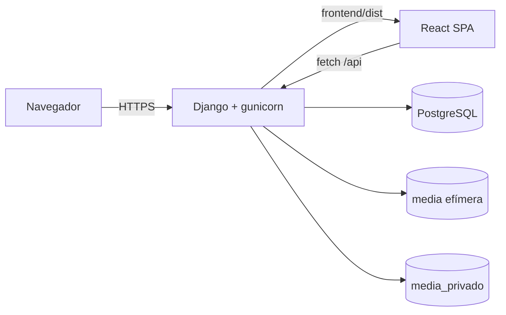
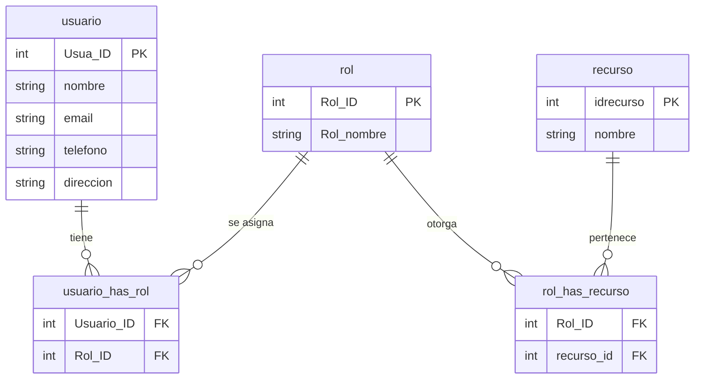
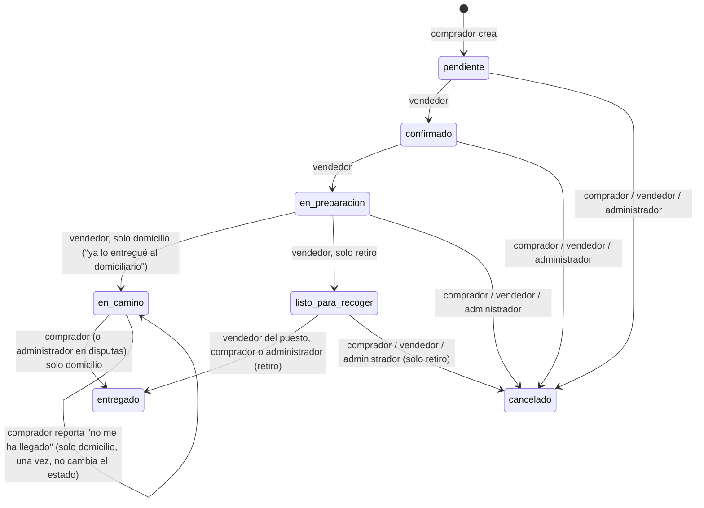

# RioMarket

Marketplace local para los puestos de mercado de Riohacha (Colombia). Incluye la **API REST** en Django/DRF y la **SPA** en React/Vite: catálogo, pedidos, pagos, verificación de vendedores, reseñas, cupones, notificaciones y auditoría.

[](https://www.python.org/) [](https://www.djangoproject.com/)
[](https://www.django-rest-framework.org/) [](https://react.dev/)
[](https://www.postgresql.org/) [](https://github.com/calo159/riomarket-backend/actions/workflows/ci.yml)

> **Demo:** <https://riomarket.onrender.com> (URL por defecto del Blueprint; puede variar). El plan gratuito de Render duerme el servicio tras unos minutos sin tráfico: la primera visita puede tardar cerca de un minuto en responder.

## Contenido

- [Qué es](#qué-es-riomarket) · [Funcionalidades](#funcionalidades-y-estado) · [Arquitectura](#arquitectura) · [Stack](#stack) · [Inicio](#inicio-rápido) · [Datos](#datos-demo)
- [Configuración](#configuración) · [Autenticación](#autenticación-y-roles) · [API](#api) · [Administración y RBAC](#administración-y-rbac) · [Frontend](#frontend) · [Pruebas](#pruebas)
- [Despliegue](#despliegue-en-render) · [Seguridad](#seguridad-y-limitaciones) · [Estructura](#estructura) · [Documentación](#documentación) · [Problemas](#solución-de-problemas) · [Roadmap](#roadmap) · [Contribuir y licencia](#contribuir-licencia-y-autores)

## Qué es RioMarket

RioMarket conecta vendedores de puestos con compradores locales sin obligarlos a montar una tienda propia. Un pedido pertenece a **un solo puesto**; el servidor calcula los montos, congela los precios y descuenta el stock de forma transaccional. Los roles son **comprador**, **vendedor** y **administrador**: el vendedor debe estar verificado para publicar y el comprador solo puede reseñar pedidos entregados.

## Funcionalidades y estado

| Área | Estado | Detalle |
| --- | --- | --- |
| Sesión | Listo | JWT de acceso en memoria + refresh en cookie HttpOnly |
| Catálogo y compra | Listo | Puestos, categorías, productos, imágenes, filtros, carrito y checkout |
| Pedidos | Listo | Un puesto por pedido, estados, stock transaccional y cancelación |
| Apartar con plazo | Listo | Un retiro que nadie confirma o recoge a tiempo se cancela solo (24 h, configurable por puesto de 2 a 72 h) y el stock vuelve; el vendedor puede dar más tiempo hasta 2 veces. Domicilios y pedidos pagados no vencen. Sin cron: barrido perezoso al leer y comando al arrancar ([ADR-012](docs/ADR-012-apartar-con-plazo.md)) |
| Panel de ventas | Listo | El vendedor ve ventas por día (7, 30 o 90 días), ingreso neto, ticket promedio, lo más vendido y sus pedidos por estado; el administrador, el mercado completo con filtro por puesto. Gráficos propios en SVG con alternativa en tabla ([ADR-014](docs/ADR-014-panel-de-ventas.md)) |
| Productos por encargo | Listo | Tortas, pudines y similares: el vendedor publica un producto sin stock con tiempo de preparación; el comprador escribe sus detalles y elige para cuándo lo quiere; el puesto «acepta» con el Confirmar de siempre. Se pueden mezclar con productos con stock; cancelar repone solo el stock de los ítems con stock ([ADR-013](docs/ADR-013-productos-por-encargo.md)) |
| Pagos | Listo (sandbox) | Efectivo confirmado por el vendedor y simulación; sin pasarela real |
| Verificación | Listo | Cédula cifrada, foto privada y aprobación o rechazo por el administrador |
| Reseñas, cupones y avisos | Listo | Reseñas solo de pedidos entregados; cupones por puesto; correo opcional |
| Paneles | Listo | Comprador, vendedor y administrador en una sola SPA |
| Administración y RBAC | Listo | Usuarios (rol base, roles adicionales y baneo), roles, recursos, menú dinámico por recursos, moderación de puestos/productos, categorías, reseñas y resumen, todo con auditoría |
| Contacto por WhatsApp | Listo | Botón «Escribir por WhatsApp» en el puesto y el producto; **apagado por defecto**: el vendedor lo activa y solo se publica con puesto activo y vendedor verificado ([ADR-010](docs/ADR-010-contacto-mapa-y-pwa.md)) |
| Mapa de puestos | Listo | `/mapa` con Leaflet y OpenStreetMap (chunk diferido), mini-mapa y «Cómo llegar» en cada puesto |
| Volver a pedir | Listo | Repite un pedido entregado o cancelado con el stock y los productos actuales |
| App instalable (PWA) | Listo | Manifest, íconos y service worker mínimo que solo muestra una página sin conexión; no guarda en caché la app ni la API |
| Recuperar y cambiar la contraseña | Solo API | `POST /api/auth/recuperar-contrasena/`, `restablecer-contrasena/` y `perfil/cambiar-contrasena/` existen y tienen pruebas; la SPA no tiene pantalla para ellos y el correo depende de un SMTP que la demo no configura |
| Pasarela de pago real | No incluido | Solo sandbox y efectivo al recoger |

## Arquitectura

En desarrollo, Vite sirve la SPA en el puerto 3000 y hace proxy de `/api` y `/media` hacia Django (puerto 8000). En producción, Django con WhiteNoise sirve el build de la SPA y mantiene la API bajo `/api`, de modo que todo vive en el mismo origen.



`accounts` es la base; `catalog` depende de ella; `orders` y `payments` dependen de ambas; `common` es transversal; `addresses`, `notifications`, `reviews`, `promotions` y `audit` se apoyan en las anteriores. Cada app separa `models / serializers / services / views / urls / tests`, y las reglas de negocio viven en `services.py`.

### Flujo de un pedido

Los pedidos de **domicilio** y de **retiro en el puesto** siguen caminos distintos (ver [ADR-009](docs/ADR-009-retiro-y-pago-al-recoger.md)):

```mermaid
stateDiagram-v2
    [*] --> pendiente
    pendiente --> confirmado: vendedor (pago aprobado; en retiro basta efectivo registrado)
    pendiente --> cancelado
    confirmado --> en_preparacion
    confirmado --> cancelado
    en_preparacion --> en_camino: domicilio, vendedor entrega al domiciliario
    en_preparacion --> listo_para_recoger: retiro, vendedor avisa
    en_preparacion --> cancelado
    en_camino --> entregado: domicilio, comprador confirma recepción
    en_camino --> en_camino: comprador reporta no-recibido (solo domicilio)
    listo_para_recoger --> entregado: retiro, vendedor entrega y cobra (o comprador/admin)
    listo_para_recoger --> cancelado
    entregado --> [*]
    cancelado --> [*]
```



El vendedor confirma y prepara el pedido. En **domicilio** lo marca en camino y solo el comprador confirma que lo recibió (si no le llega, puede reportarlo y el administrador resuelve la disputa). En **retiro** nadie lo lleva: el vendedor lo marca «listo para recoger» y, cuando el cliente pasa por el puesto, lo entrega y cobra en mano (el comprador y el administrador también pueden cerrar la entrega, pero un efectivo sin cobrar solo lo cierra el vendedor o el administrador).  Cualquiera de las partes puede cancelar mientras el pedido no haya salido del puesto. Al cancelar se repone el stock y se reembolsa o anula el pago. El comprador paga `subtotal + domicilio - descuento` y la comisión de la plataforma se descuenta al vendedor.

## Stack

| Capa | Tecnología |
| --- | --- |
| Backend | Python 3.12, Django 5.2, DRF 3.18, SimpleJWT, drf-spectacular |
| Datos | PostgreSQL 16 (Render o Supabase); SQLite en memoria para las pruebas |
| Frontend | React 18, TypeScript estricto, Vite 7, React Router 7, TanStack Query, Tailwind |
| Calidad | pytest, ruff, Vitest, Testing Library, Playwright, ESLint, GitHub Actions |
| Entrega | Docker Compose para desarrollo; Render para la demo |

## Inicio rápido

Requisitos: Python 3.12, Node.js 22.12+ y PostgreSQL 16 (o Docker). El `.env` **no** se versiona: cópialo desde `.env.example` y completa `SECRET_KEY`, `FERNET_KEY` y `DATABASE_URL`.

### 1. Backend

**Con Docker:**

```bash
git clone https://github.com/calo159/riomarket-backend.git
cd riomarket-backend
docker compose up --build -d
docker compose exec web python manage.py migrate
docker compose exec web python manage.py seed_masivo
```

**Sin Docker:**

```bash
git clone https://github.com/calo159/riomarket-backend.git
cd riomarket-backend
python -m venv .venv
.venv\Scripts\Activate.ps1    # Windows PowerShell
source .venv/bin/activate     # Linux/macOS (usa solo la línea de tu sistema)
pip install -r requirements-dev.txt
python manage.py migrate
python manage.py seed_masivo
python manage.py runserver
```

Tu `.env` define la base (`DATABASE_URL`). El backend queda en <http://127.0.0.1:8000>: salud en `/api/health/`, Swagger en `/api/docs/`, Redoc en `/api/docs/redoc/`, esquema en `/api/schema/` y administración en `/admin/`.

### 2. Frontend (otra terminal)

```bash
cd frontend
npm ci
cp .env.example .env          # Windows: copy .env.example .env
npm run dev
```

### 3. Abrir la aplicación

Entra a <http://127.0.0.1:3000> (usa `127.0.0.1`, no `localhost`: la cookie de sesión es `SameSite=Strict`) e inicia sesión con alguno de los usuarios de la sección siguiente.

## Datos demo

Contraseña para todos: `RioMarket2026!` (se cambia con `--password` o con `SEED_DEMO_PASSWORD`).

| Rol | Correo |
| --- | --- |
| Administrador | `admin@riomarket.test` |
| Vendedor aprobado | `carmen@riomarket.test` |
| Vendedor aprobado | `diego@riomarket.test` |
| Comprador | `luis@riomarket.test` |

`seed_masivo` es idempotente y, en una base limpia, la primera ejecución crea **522 registros** según el reporte final del comando (15 usuarios incluidos; desde la segunda ejecución el reporte dice 525, porque `cancelar_pedidos_vencidos`, que corre al arrancar, cancela `SM-31` y suma su aviso y su registro de auditoría): 8 categorías, 6 puestos, 41 productos (uno por encargo: la bandeja de dulce de papaya con queso), 32 pedidos (uno de retiro «listo para recoger» con el efectivo por cobrar, `SM-28`; otro, `SM-31`, con el plazo vencido a propósito para mostrar «Se canceló solo»; y un encargo pendiente, `SM-32`), 30 pagos, 129 notificaciones y 178 registros de auditoría. En cada ejecución renueva el plazo de los pedidos demo abiertos (7 días) para que el sistema no los cancele; solo `SM-31` queda vencido y lo cancela `cancelar_pedidos_vencidos` en el arranque. `seed_demo` crea solo 28 registros. En Render se ejecuta `seed_masivo` en cada arranque: actualiza las contraseñas demo y siembra lo que falte.

Los IDs de los ejemplos de [`docs/api-ejemplos.md`](docs/api-ejemplos.md) corresponden a una base recién sembrada.

### Prueba rápida (3 minutos)

1. Entra como **comprador** (`luis@riomarket.test`), busca un producto y agrégalo al carrito.
2. Haz el checkout eligiendo retiro o domicilio y paga (efectivo o simulado).
3. Entra como **vendedor** (`carmen@riomarket.test`), confirma el pedido (en retiro basta el pago en efectivo registrado: se cobra al recoger) y avánzalo: confirmado, en preparación y listo para recoger (en domicilio, en camino); en retiro, «Entregar y cobrar».
4. Vuelve como comprador: en domicilio, si no llegó usa "No me ha llegado" y, cuando lo recibas, confirma "Ya recibí mi pedido"; en retiro el vendedor te entrega y cobra en el puesto. Después deja una reseña.
5. Entra como **administrador** (`admin@riomarket.test`) y revisa el resumen, usuarios, pedidos, pagos y auditoría.

## Configuración

`.env.example` documenta todas las variables; las principales son:

| Variable | Uso | Demo |
| --- | --- | --- |
| `DEBUG` / `DJANGO_SETTINGS_MODULE` | Entorno activo | `True` / `config.settings.dev` |
| `SECRET_KEY` / `FERNET_KEY` | Firma y cifrado; Fernet es obligatoria en producción | Valores de demo |
| `ALLOWED_HOSTS` | Hosts permitidos | `localhost,127.0.0.1,web` |
| `DATABASE_URL` / `CONN_MAX_AGE` | PostgreSQL y persistencia de conexiones | Supabase / `60` |
| `CORS_ALLOWED_ORIGINS` / `CSRF_TRUSTED_ORIGINS` | Orígenes de la SPA y HTTPS | Local / `https://*.onrender.com` |
| `DOMICILIO_TARIFA_BASE` / `PLATFORM_COMMISSION_PERCENTAGE` | Tarifa de domicilio y comisión | `3000.00` / `5.00` |
| `PAYMENTS_SANDBOX_ENABLED` / `SEED_DEMO` | Sandbox de pagos y seed en Render | `True` / `true` |
| `PEDIDOS_PLAZO_CONFIRMACION_HORAS` / `PEDIDOS_AVISO_ANTES_HORAS` / `PEDIDOS_LIBERAR_EN_LECTURA` | Plazo para confirmar un retiro (24), aviso previo (2 h) y barrido al leer (`True`); opcionales | valores por defecto |

Para liberar a mano lo vencido: `python manage.py cancelar_pedidos_vencidos [--dry-run] [--limite N]` (también corre al arrancar en Render).

Para producción genera las claves así:

```bash
python -c "from django.core.management.utils import get_random_secret_key; print(get_random_secret_key())"   # SECRET_KEY
python -c "from cryptography.fernet import Fernet; print(Fernet.generate_key().decode())"                   # FERNET_KEY
```

## Autenticación y roles

- El `access` JWT viaja en `Authorization: Bearer` y vive solo en memoria en la SPA. Dura 15 minutos por defecto.
- El `refresh` viaja en la cookie `rm_refresh`: `HttpOnly`, `SameSite=Strict`, `Secure` fuera de desarrollo y `path=/api/auth/`. **No** se devuelve en el cuerpo del login.
- Renovar y cerrar sesión exigen la cabecera `X-Requested-With: XMLHttpRequest`; el frontend la envía automáticamente. El refresh rota y el anterior queda en lista negra.
- El login devuelve `{access, usuario}`. Si el refresh falla, la SPA limpia la sesión y redirige a `/login?expirada=1`.
- **Comprador:** compra, direcciones y reseñas. **Vendedor:** catálogo propio, pedidos y cupones. **Administrador:** usuarios, verificaciones, moderación, pagos y auditoría.
- El menú de la SPA sale de `GET /api/auth/menu/`: son los **recursos** que los roles de la persona le otorgan (ver [Administración y RBAC](#administración-y-rbac)). Si el administrador cambia un rol o un recurso, el menú cambia en la siguiente petición.

### RBAC de pedidos

Cada pedido incluye `acciones_permitidas` (RBAC × estado) y el frontend solo pinta botones desde esa lista.

| Acción | Comprador del pedido | Vendedor del puesto | Administrador |
| --- | --- | --- | --- |
| Crear | Sí | No | No |
| Editar / cancelar | Sí (mientras no salga) | Sí (mientras no salga) | Sí |
| Confirmar / preparación / enviar (domicilio) / marcar listo para recoger (retiro) | No | Sí | Sí |
| Entregar | Sí (confirma recepción; en retiro con efectivo sin cobrar, no) | Solo en retiro (entrega y cobra) | Sí (resuelve disputas) |
| Reportar "no me llegó" | Sí (solo domicilio en camino, una vez) | No | No |

El flujo completo con `curl` y respuestas reales está en [`docs/api-ejemplos.md`](docs/api-ejemplos.md); la demo de 6 pasos, en [`entrega/flujo_prueba.curl.md`](entrega/flujo_prueba.curl.md).

## API

La API está documentada con OpenAPI (Swagger en `/api/docs/`). Módulos principales:

| Módulo | Prefijo | Recursos |
| --- | --- | --- |
| Autenticación | `/api/auth/` | Registro, login, refresh, logout, perfil, menú, recuperación y cambio de contraseña |
| Catálogo | `/api/catalog/` | Categorías, puestos, productos e imágenes |
| Pedidos y pagos | `/api/orders/` · `/api/payments/` | Estados, ítems, efectivo, sandbox y webhook |
| Direcciones y verificación | `/api/addresses/` · `/api/verificacion/` | Libreta de direcciones y revisión de vendedores |
| Reseñas y promociones | `/api/reviews/` · `/api/promotions/` | Reseñas, respuestas, cupones y su validación |
| Notificaciones, auditoría y salud | `/api/notifications/` · `/api/audit/` · `/api/health/` | Bandeja, consulta para el administrador y estado del servicio |

La paginación usa `page`, `page_size` (máximo 100) y `ordering` con listas blancas por módulo. Los errores tienen siempre la forma `{"success": false, "status_code": 400, "errors": {...}}`.

## Administración y RBAC

El administrador gestiona **usuarios, roles y recursos** con el modelo RBAC del diagrama del profesor (app `apps/rbac`, API en `/api/admin/`).



La relación usuario–rol y rol–recurso es **N:M** a través de `usuario_has_rol` y `rol_has_recurso` (tablas con esos nombres exactos). En el código: `usuario` es `accounts.Usuario` (correo, celular y direcciones viven allí y en `addresses`), y `rol`, `recurso` y las dos tablas puente son los modelos de `apps/rbac`.

### Cómo funciona

- **Rol base + roles adicionales.** `Usuario.rol` (comprador, vendedor, administrador) se conserva como *rol base*: de él dependen los pedidos, el panel del vendedor y el JWT. Cada rol base existe también como `Rol` de sistema y una señal mantiene su fila en `usuario_has_rol`. Los roles base son excluyentes; los **roles personalizados se suman**.
- **Permisos efectivos** = recursos *activos* de los roles *activos* del usuario (asignados + rol base) **más** los recursos públicos. Anónimos y cuentas suspendidas solo ven lo público. No hay atajo por rol base: si se le quita `admin.auditoria` al rol administrador, el acceso se pierde de verdad.
- **Menú dinámico.** `GET /api/auth/menu/` devuelve `{rol, roles, recursos, items, badges}`; los ítems son los recursos activos con ruta que el usuario puede ver. El frontend pinta lo que llega y protege cada ruta de panel con su recurso.
- **Candados anti-bloqueo:** los roles y recursos de sistema no se eliminan ni desactivan (en roles solo se edita la descripción; en recursos no se cambian `codigo`, `ruta`, `ambito`, `es_publico`); el rol administrador no puede perder `admin.usuarios`, `admin.roles`, `admin.recursos` ni `admin.resumen`; nunca queda el sistema sin un administrador activo.
- **Candados anti-escalada:** nadie cambia su propio rol, sus roles adicionales ni se suspende; solo un administrador base otorga el rol administrador o modifica/suspende a otro administrador; quien no es administrador base no puede cambiar los recursos de un rol que él mismo tiene.
- Cada acción sensible exige `motivo` (5 a 300 caracteres), se **audita** (entidad `usuario|rol|recurso|puesto|producto`, con campo, de, a y motivo) y, si afecta a una persona, la **notifica**. Cambiar el rol base o banear además **invalida sus sesiones**; los cambios de rol↔recurso no lo necesitan porque los permisos se calculan en cada petición.

### Reglas de los usuarios

- **Cambio de rol base** (`cambiar-rol`): rol distinto y válido, motivo obligatorio y sin pedidos activos (como comprador o en sus puestos). A vendedor reutiliza su registro de verificación o crea uno *pendiente* (no publica hasta que lo aprueben); de vendedor a otro rol sus puestos activos pasan a `inactivo` y se conserva la verificación.
- **Banear = suspender:** no inicia sesión, conserva rol e historial; sus puestos activos pasan a `suspendido` y no se tocan los pedidos. **Reactivar** solo devuelve la cuenta (los puestos se reactivan desde Puestos). No se borran usuarios.

### Catálogo de recursos por defecto

Todos son de sistema (`es_sistema`). «Rol» indica quién los recibe al sembrar; el administrador puede reasignarlos.

| Ámbito | Recursos (código → ruta) | Rol |
| --- | --- | --- |
| Público | `catalogo` → `/catalogo` (visible sin sesión) | todos |
| Cuenta | `mis_pedidos`, `direcciones` → `/mis-pedidos`, `/direcciones` | comprador |
| Cuenta | `notificaciones`, `perfil` → `/notificaciones`, `/perfil` | los tres |
| Panel vendedor | `vendedor.resumen` (`/vendedor`), `.verificacion`, `.puestos`, `.productos`, `.pedidos`, `.cupones`, `.resenas` (`/vendedor/...`) | vendedor |
| Panel admin · Accesos | `admin.usuarios`, `admin.roles`, `admin.recursos` | administrador |
| Panel admin · Gestión | `admin.verificaciones`, `admin.puestos`, `admin.productos`, `admin.categorias` | administrador |
| Panel admin · Operación | `admin.pedidos`, `admin.pagos`, `admin.cupones`, `admin.resenas` | administrador |
| Panel admin · Sistema | `admin.auditoria` | administrador |
| Panel admin | `admin.resumen` → `/admin` | administrador |

`python manage.py seed_rbac` (también lo llaman `seed_demo` y `seed_masivo`) es idempotente: solo **agrega** lo que falta, no sobrescribe ediciones del administrador ni re-vincula recursos que él quitó.

### Qué se hace cumplir en el backend y qué solo en el menú

| Control | Backend (`TieneRecurso` / `tiene_recurso`) | Solo menú y rutas del frontend |
| --- | --- | --- |
| `admin.usuarios`, `admin.roles`, `admin.recursos`, `admin.resumen` | Sí | — |
| `admin.puestos`, `admin.productos` (moderar y ver todo) | Sí | — |
| `admin.categorias` (escritura), `admin.verificaciones`, `admin.pagos` (reembolsar/anular), `admin.auditoria` | Sí | — |
| `admin.resenas` (borrar/ver cualquier reseña), `admin.pedidos` (ver todos los pedidos) | Sí, en la visibilidad global | Menú y ruta |
| `admin.cupones` | — | Menú y ruta |
| `mis_pedidos`, `direcciones`, `notificaciones`, `perfil`, `vendedor.*` | — (las reglas de negocio siguen ligadas al **rol base**) | Menú y ruta |

Las acciones de pedido (crear, confirmar, enviar, entregar…) siguen la matriz por rol base de la sección *RBAC de pedidos*.

### Estados del pedido y quién ejecuta cada transición



### Endpoints

| Método | Ruta | Recurso | Uso |
| --- | --- | --- | --- |
| GET | `/api/admin/usuarios/` | `admin.usuarios` | Filtros `rol`, `estado`, `rol_asignado`, `q`, `ordering`; incluye `roles_asignados` y `acciones_permitidas` |
| POST | `/api/admin/usuarios/{id}/cambiar-rol/` | + `admin.roles` | `{rol, motivo}` |
| PUT | `/api/admin/usuarios/{id}/roles/` | + `admin.roles` | `{roles: [ids personalizados], motivo}` reemplaza los roles adicionales |
| POST | `/api/admin/usuarios/{id}/suspender/` · `reactivar/` | `admin.usuarios` | `{motivo}` / sin cuerpo |
| GET/POST | `/api/admin/roles/` · GET/PATCH/DELETE `/{id}/` | `admin.roles` | CRUD de roles; eliminar solo sin usuarios |
| PUT | `/api/admin/roles/{id}/recursos/` | `admin.roles` | `{recursos: [ids], motivo}` |
| GET/POST | `/api/admin/recursos/` · GET/PATCH/DELETE `/{id}/` | `admin.recursos` | Filtros `ambito`, `activo`, `q`; eliminar informa `roles_afectados` |
| GET | `/api/admin/resumen/` | `admin.resumen` | Métricas y alertas |
| GET | `/api/payments/ventas/` | `vendedor.ventas` (vendedor) · administrador | Panel de ventas: `dias` 7/30/90, `puesto`; totales, serie diaria en hora de Colombia, top 5 productos y pedidos por estado ([ADR-014](docs/ADR-014-panel-de-ventas.md)) |
| POST | `/api/catalog/puestos/{id}/moderar/` | `admin.puestos` | `{estado: activo\|inactivo\|suspendido, motivo}` (motivo obligatorio al restringir) |
| POST | `/api/catalog/productos/{id}/moderar/` | `admin.productos` | `{estado: activo\|bloqueado, motivo}` |
| GET | `/api/auth/menu/` | público | Menú del usuario actual (anónimo: solo lo público) |

```bash
TOKEN="<access del administrador>"
H=(-H "Authorization: Bearer $TOKEN" -H "Content-Type: application/json")

# 1. Crear un rol y darle recursos (ids de GET /api/admin/recursos/)
curl -X POST http://127.0.0.1:8000/api/admin/roles/ "${H[@]}" \
  -d '{"nombre": "moderador", "descripcion": "Modera puestos y productos"}'
curl -X PUT http://127.0.0.1:8000/api/admin/roles/4/recursos/ "${H[@]}" \
  -d '{"recursos": [14, 15, 22], "motivo": "Equipo de moderación"}'

# 2. Crear un recurso nuevo
curl -X POST http://127.0.0.1:8000/api/admin/recursos/ "${H[@]}" \
  -d '{"codigo": "admin.reportes", "nombre": "Reportes", "ambito": "panel_admin", "ruta": "/admin/reportes", "icono": "BarChart", "grupo": "Operación", "orden": 9}'

# 3. Asignar roles adicionales a un usuario
curl -X PUT http://127.0.0.1:8000/api/admin/usuarios/12/roles/ "${H[@]}" \
  -d '{"roles": [4], "motivo": "Pasa al equipo de moderación"}'

# 4. Cambiar el rol base y banear
curl -X POST http://127.0.0.1:8000/api/admin/usuarios/12/cambiar-rol/ "${H[@]}" \
  -d '{"rol": "vendedor", "motivo": "Solicitó publicar sus productos"}'
curl -X POST http://127.0.0.1:8000/api/admin/usuarios/12/suspender/ "${H[@]}" \
  -d '{"motivo": "Incumplimiento reiterado de las normas"}'

# 5. Menú del usuario actual (sin token: solo lo público)
curl http://127.0.0.1:8000/api/auth/menu/ -H "Authorization: Bearer $TOKEN"
```

## Frontend

La SPA está en [`frontend/`](frontend/README.md); su estado y sus limitaciones están en [`frontend/README.md#estado-de-cumplimiento`](frontend/README.md#estado-de-cumplimiento). Los comandos de arranque están en [Inicio rápido](#2-frontend-otra-terminal).

- **Landing** (`/`): presentación para compradores y vendedores; con sesión iniciada redirige al inicio del rol.
- **Comprador** (`/tienda`): catálogo, carrito, checkout, pedidos (con «Volver a pedir»), direcciones y perfil.
- **Mapa público** (`/mapa`): los puestos con ubicación sobre OpenStreetMap, con lista accesible; en cada puesto, mini-mapa, «Cómo llegar» y WhatsApp si el vendedor lo activó.
- **Vendedor** (`/vendedor`): ventas, puestos, productos, pedidos, cupones, reseñas y verificación.
- **Administrador** (`/admin`): resumen con alertas y ventas del mercado, usuarios, verificaciones, pedidos, puestos, productos, categorías, reseñas, pagos, cupones y auditoría. El menú y los accesos se generan desde el backend.

Vite corre en `127.0.0.1:3000` y hace proxy de `/api` y `/media`. Si defines `VITE_API_URL`, usa el mismo host de la SPA para que la cookie `SameSite=Strict` siga siendo del mismo sitio. El acceso rápido con las cuentas demo del login se activa con `VITE_DEMO_MODE=true`.

### Permisos de pedidos por rol

La fuente de verdad es `apps/orders/permissions.py`; el comprador solo actúa
sobre **su** pedido y el vendedor sobre los de **su** puesto. El administrador
resuelve disputas y no crea pedidos. `acciones_permitidas` de la API expone
esta matriz combinada con el estado actual.

| Acción | Comprador | Vendedor del puesto | Administrador |
| --- | :---: | :---: | :---: |
| Crear pedido | ✅ | — | — |
| Editar dirección/notas (pendiente) | ✅ | — | ✅ |
| Confirmar pedido | — | ✅ | ✅ |
| Pasar a preparación | — | ✅ | ✅ |
| Marcar en camino (domicilio) | — | ✅ | ✅ |
| Marcar listo para recoger (retiro) | — | ✅ | ✅ |
| Confirmar recepción (`entregado`) | ✅ (en retiro con efectivo sin cobrar, no) | ✅ (solo retiro; cobra el efectivo) | ✅ |
| Reportar `no-recibido` (domicilio en camino) | ✅ | — | ✅ |
| Cancelar | ✅ | ✅ | ✅ |

## Pruebas

Backend:

```bash
pytest -q --cov=apps   # falla bajo el 91 % de cobertura (pyproject.toml)
ruff check apps config tests scripts --no-cache
ruff format --check apps config tests scripts
python manage.py makemigrations --check --dry-run
python manage.py spectacular --file schema.yaml --validate
python scripts/trazabilidad.py --check   # matriz de trazabilidad al día
```

Resultado medido el 31/10/2026 (SQLite local): **1385 pruebas** recolectadas, 1384 en verde y 1 omitida (la de `SKIP LOCKED`, que solo corre en PostgreSQL, es decir en el CI); **cobertura de `apps/` del 94 %** con ramas (`pytest --cov=apps`; el CI exige al menos 91 %). La cobertura del frontend aún no se mide: falta `@vitest/coverage-v8` y no se añadió ninguna dependencia nueva en esta entrega ([ADR-015](docs/ADR-015-observabilidad.md)); lint y formato correctos, sin migraciones pendientes y OpenAPI sin errores (4 avisos: nombres de `enum` y un parámetro de ruta sin tipo). La suite usa SQLite en memoria; para probar contra PostgreSQL real, exporta `TEST_DATABASE_URL`. La matriz [`docs/trazabilidad.md`](docs/trazabilidad.md) enlaza cada requisito con sus pruebas.

Frontend (`cd frontend`):

```bash
npm run lint
npm run typecheck
npm test
npm run build
```

Resultado: **260 pruebas en 41 archivos** (`npx vitest run`), con lint, typecheck y build en verde. El smoke test E2E se ejecuta con `npm run test:e2e` después de `npx playwright install chromium`.

Dependencias (31/10/2026): `pip-audit -r requirements.txt` no reporta vulnerabilidades conocidas. `npm audit` reporta **17 avisos moderados**, todos en herramientas de desarrollo (ESLint), y **ninguno** en las dependencias de producción (`npm audit --omit=dev`). La línea base anterior está en [`docs/MANTENIMIENTO.md`](docs/MANTENIMIENTO.md); los límites aceptados, en [`SECURITY.md`](SECURITY.md).

## Despliegue en Render

`render.yaml` crea un servicio Docker y una base PostgreSQL 16 gratuita. `scripts/render-start.sh` ejecuta `collectstatic`, `migrate`, `seed_masivo` y `seed_imagenes_demo`, completa las miniaturas pendientes (`generar_miniaturas`) y luego inicia gunicorn. `Dockerfile.render` compila la SPA, la comprime (Brotli y gzip) y WhiteNoise sirve los archivos estáticos con caché inmutable para los que llevan hash. Django también responde `/robots.txt` y `/sitemap.xml` y completa las metaetiquetas Open Graph de cada ruta ([ADR-011](docs/ADR-011-rendimiento-y-seo.md)).

1. Sube el repositorio a GitHub (rama `main`).
2. En Render, elige **New → Blueprint** y conecta el repositorio.
3. Confirma los recursos y espera a que termine el deploy.
4. Verifica `/api/health/`, `/api/docs/`, `/` (landing), `/tienda`, `/robots.txt` y `/sitemap.xml`.

La URL depende del nombre del servicio; la del Blueprint es `https://riomarket.onrender.com`. Límites del plan gratuito: el servicio se duerme, la base **caduca a los 30 días** y el disco es efímero. Para una base duradera usa Supabase y reemplaza `DATABASE_URL`. Más detalles en [`docs/despliegue.md`](docs/despliegue.md).

## Seguridad y limitaciones

- No hay pasarela de pago real: solo existe `PasarelaSandbox` (ver [`SECURITY.md`](SECURITY.md)). En producción real hay que desactivar `PAYMENTS_SANDBOX_ENABLED` e integrar un proveedor.
- El correo es opcional y depende de SMTP; la demo usa solo avisos dentro de la aplicación.
- No se crean ni eliminan usuarios desde el panel (solo cambian de rol o se suspenden). La recuperación y el cambio de contraseña existen solo en la API: la SPA no tiene pantalla para ellos.
- `media/` y `media_privado/` usan disco local, que es efímero en Render. La foto de la cédula se cifra y se sirve solo por una vista autorizada.
- Las imágenes y la cédula se validan por tipo y tamaño; los tokens y secretos no se registran en los logs.
- **`.env` ya no se versiona**, pero estuvo en el historial público de git. El dueño decidió conscientemente no rotar esas claves por ahora; queda documentado como límite en [`SECURITY.md`](SECURITY.md) (hallazgo S-01 de [`docs/AUDITORIA.md`](docs/AUDITORIA.md)). Antes de usar datos reales hay que rotar la contraseña de la base, `SECRET_KEY` y `FERNET_KEY` (y re-cifrar las cédulas).
- No hay archivo `LICENSE`; el responsable debe elegir uno antes de reutilizar el código fuera del contexto académico.

Cómo reportar una vulnerabilidad está en [`SECURITY.md`](SECURITY.md); el detalle de los controles (JWT, cookies, CSP, cifrado con Fernet, límites de peticiones y permisos), en [`SEGURIDAD.md`](SEGURIDAD.md).

## Estructura

```text
riomarket-backend/
├── apps/                  # accounts, catalog, orders, payments, addresses, notifications,
│                          # reviews, promotions, audit, rbac, administration, common
├── config/                # settings dev/test/prod, URLs, WSGI y ASGI
├── docs/                  # arquitectura, diagramas, trazabilidad, API, despliegue, ADRs y guion
├── entrega/               # guía, flujo curl, respaldos de datos y Postman
├── frontend/              # SPA React/Vite, pruebas y configuración
├── scripts/               # arranque en Render y verificación de la trazabilidad
├── tests/                 # pruebas transversales y factories
├── .github/workflows/     # CI de backend y frontend
├── CHANGELOG.md · SECURITY.md · CONTRIBUTING.md
├── Dockerfile             # desarrollo (docker-compose)
├── Dockerfile.render      # producción (compila la SPA y arranca gunicorn)
├── docker-compose.yml     # PostgreSQL, Redis y backend
├── render.yaml            # Blueprint de Render
├── requirements.txt / requirements-dev.txt
└── manage.py
```

## Documentación

- **Guías:** [Índice](docs/README.md) · [Arquitectura y permisos](docs/arquitectura.md) · [Diagramas de secuencia y despliegue](docs/diagramas.md) · [Ejemplos de la API](docs/api-ejemplos.md) · [Despliegue](docs/despliegue.md) · [Alcance del frontend](docs/alcance-frontend.md)
- **Ingeniería:** [Matriz de trazabilidad](docs/trazabilidad.md) (generada desde [`requisitos.yml`](docs/requisitos.yml)) · [Guion de demostración de 5 minutos](docs/PRESENTACION.md) · [Rendimiento](docs/rendimiento.md) · [Registro de cambios](CHANGELOG.md)
- **Proyecto:** [Mantenimiento](docs/MANTENIMIENTO.md) · [Auditoría](docs/AUDITORIA.md) · [Seguridad (controles)](SEGURIDAD.md) · [Política de seguridad](SECURITY.md) · [Cómo contribuir](CONTRIBUTING.md)
- **Entrega:** [Guía de entrega](entrega/LEEME_ENTREGA.md) · [Flujo curl](entrega/flujo_prueba.curl.md) · [Colección Postman](entrega/riomarket_postman.json)
- **Decisiones (ADR):** [enums](docs/ADR-001-enums.md) · [media](docs/ADR-002-media-publica-y-privada.md) · [pagos](docs/ADR-003-pagos.md) · [direcciones](docs/ADR-004-direcciones-y-notificaciones.md) · [reseñas](docs/ADR-005-reputacion-resenas.md) · [cupones](docs/ADR-006-promociones-cupones.md) · [auditoría](docs/ADR-007-auditoria.md) · [imágenes](docs/ADR-008-almacenamiento-imagenes.md) · [retiro y pago al recoger](docs/ADR-009-retiro-y-pago-al-recoger.md) · [contacto, mapa y PWA](docs/ADR-010-contacto-mapa-y-pwa.md) · [rendimiento y SEO](docs/ADR-011-rendimiento-y-seo.md) · [apartar con plazo](docs/ADR-012-apartar-con-plazo.md) · [encargos](docs/ADR-013-productos-por-encargo.md) · [panel de ventas](docs/ADR-014-panel-de-ventas.md)

## Solución de problemas

- **`no such table` o migraciones pendientes:** ejecuta `migrate` y luego `seed_masivo`.
- **`FERNET_KEY es obligatoria`:** define una clave Fernet cuando `DEBUG=False`; no actives `DEBUG` en producción.
- **401 al renovar la sesión:** la cookie es `SameSite=Strict`; abre la SPA en `127.0.0.1:3000` y no mezcles `localhost` con `127.0.0.1`. Revisa también `CORS_ALLOWED_ORIGINS`.
- **Render tarda en responder:** el plan gratuito durmió el servicio; la primera petición puede tardar cerca de un minuto.
- **Las imágenes desaparecen en Render:** el disco es efímero; usa almacenamiento externo en producción.
- **Playwright no arranca:** ejecuta `npx playwright install chromium`.
- **Puerto 3000 ocupado:** Vite usa `strictPort`; libera el puerto o cierra la otra instancia.

## Roadmap

- Integrar una pasarela de pago real con webhooks firmados y conciliación.
- Añadir alta de usuarios desde el panel y pantallas de recuperación y cambio de contraseña en la SPA (la API ya existe).
- Enviar correos transaccionales y notificaciones en tiempo real.
- Migrar los archivos subidos a almacenamiento durable y ampliar las pruebas E2E por rol.

## Contribuir, licencia y autores

Lee [`CONTRIBUTING.md`](CONTRIBUTING.md): crea una rama desde `main`, mantén los cambios pequeños, añade pruebas, ejecuta los comandos de la sección de pruebas (incluida la matriz de trazabilidad) y abre un pull request. No incluyas secretos reales en commits nuevos.

**Licencia:** no hay `LICENSE`;

**Autor:** [`carlos sierra , yerfrreth mejia`]. 