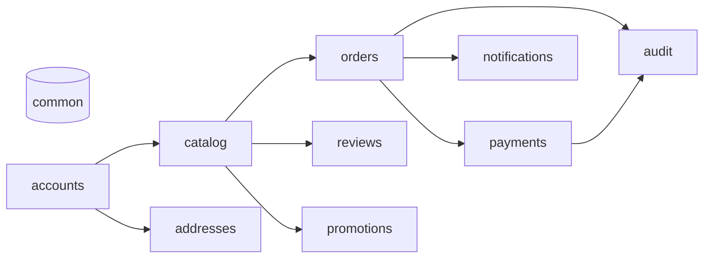

# RioMarket

Marketplace local para los puestos de mercado de Riohacha (Colombia). Este
repositorio incluye la **API REST** en Django/DRF y la **SPA** en React/Vite que
la consume: catálogo, pedidos, pagos, verificación de vendedores, reseñas,
cupones, notificaciones y auditoría.

[](https://www.python.org/)
[](https://www.djangoproject.com/)
[](https://www.django-rest-framework.org/)
[](https://react.dev/)
[](https://www.postgresql.org/)
[](https://github.com/calo159/riomarket-backend/actions/workflows/ci.yml)

## Contenido

- [Qué resuelve](#qué-resuelve)
- [Stack](#stack)
- [Arquitectura](#arquitectura)
- [Flujo de un pedido](#flujo-de-un-pedido)
- [Inicio rápido](#inicio-rápido)
- [Usuarios demo](#usuarios-demo)
- [Autenticación](#autenticación)
- [Pruebas](#pruebas)
- [Despliegue en Render](#despliegue-en-render)
- [Documentación](#documentación)
- [Limitaciones y seguridad](#limitaciones-y-seguridad)

## Qué resuelve

RioMarket conecta a vendedores de puestos de mercado con compradores locales sin
obligarlos a montar una tienda propia. Cubre publicación de productos, pedido a
un solo puesto, pago en efectivo o sandbox, domicilio, verificación de identidad,
reputación y cupones.

Roles: **comprador**, **vendedor** y **administrador**. El vendedor debe estar
verificado para publicar; el comprador puede guardar direcciones y reseñar solo
pedidos entregados.

## Stack

| Capa | Tecnología |
| --- | --- |
| Backend | Python 3.12, Django 5.2, Django REST Framework 3.18, SimpleJWT |
| Base de datos | PostgreSQL 16 (Supabase/Render); SQLite en memoria para tests |
| Frontend | React 18, TypeScript, Vite 5, React Router 6, TanStack Query, Tailwind |
| Calidad | pytest, ruff, Vitest, Testing Library, Playwright, ESLint, GitHub Actions |
| Despliegue | Docker, Docker Compose (desarrollo) y Render (producción demo) |

## Arquitectura

`accounts` es la base; `catalog` depende de ella; `orders` y `payments` cuelgan de
ambas; `common` es transversal. `addresses`, `notifications`, `reviews`,
`promotions` y `audit` se apoyan en las anteriores.



Cada app sigue `models / serializers / services / views / urls / tests`, con las
reglas de negocio en `services.py`. El ERD, las dependencias y la matriz de
permisos están en [`docs/arquitectura.md`](docs/arquitectura.md).

## Flujo de un pedido

El pedido nace `pendiente` y avanza con transiciones asignadas por rol. La
transición a `confirmado` exige un pago aprobado.

```text
pendiente -> confirmado -> en_preparacion -> en_camino -> entregado
     \___________ cancelado (repone stock una sola vez) ___________/
```

Un pedido agrupa productos de un solo puesto, congela nombre y precio en los
ítems y descuenta stock con `select_for_update`. Los montos se calculan en el
servidor desde `apps/common/pricing.py`; la comisión se descuenta al vendedor y
el comprador paga `subtotal + domicilio - descuento`.

## Inicio rápido

### Con Docker (desarrollo)

Requiere Docker y Docker Compose. Levanta PostgreSQL 16, Redis 7 y el backend
con `runserver`.

```bash
git clone https://github.com/calo159/riomarket-backend.git
cd riomarket-backend
cp .env.example .env          # Windows: copy .env.example .env
docker compose up --build -d
docker compose exec web python manage.py migrate
docker compose exec web python manage.py seed_masivo
```

El frontend se levanta aparte en <http://127.0.0.1:3000>:

```bash
cd frontend
npm ci
cp .env.example .env          # Windows: copy .env.example .env
npm run dev
```

### Local sin Docker

Necesitas Python 3.12 y una base PostgreSQL accesible en `DATABASE_URL`; el
`.env` incluido apunta a Supabase. Para una base local, ajusta esa variable.

```powershell
python -m venv .venv
.venv\Scripts\Activate.ps1
pip install -r requirements-dev.txt
copy .env.example .env
python manage.py migrate
python manage.py seed_masivo
python manage.py runserver
```

En Linux/macOS cambia la activación por `source .venv/bin/activate` y `cp` por
`copy`. El backend queda en <http://127.0.0.1:8000>.

URLs útiles:

- Health: <http://127.0.0.1:8000/api/health/>
- Swagger: <http://127.0.0.1:8000/api/docs/>
- Redoc: <http://127.0.0.1:8000/api/docs/redoc/>
- Admin: <http://127.0.0.1:8000/admin/>

## Usuarios demo

Contraseña para todos: `RioMarket2026!` (se puede cambiar con
`--password` o `SEED_DEMO_PASSWORD`).

| Rol | Correo |
| --- | --- |
| Administrador | `admin@riomarket.test` |
| Vendedor aprobado | `carmen@riomarket.test` |
| Vendedor aprobado | `diego@riomarket.test` |
| Comprador | `luis@riomarket.test` |

`seed_masivo` es idempotente, crea 15 usuarios y 522 registros de dominio en una
base limpia. `seed_demo` sigue disponible para una carga mínima. En Render se
ejecuta `seed_masivo --if-empty`: solo carga datos si la base tiene menos de 100
registros.

## Autenticación

- El `access` JWT viaja en `Authorization: Bearer` y vive solo en memoria en la
  SPA.
- El `refresh` viaja en la cookie `rm_refresh` (`HttpOnly`, `SameSite=Strict`,
  `Secure` fuera de desarrollo, `path=/api/auth/`). **No** se devuelve en el
  cuerpo del login.
- Renovar y cerrar sesión exigen la cabecera
  `X-Requested-With: XMLHttpRequest`; el frontend la envía automáticamente.
- El refresh rota y el anterior se blacklistea. Si falla, la SPA cierra sesión.
- La autorización real siempre la valida el backend; el frontend solo oculta
  rutas y acciones.

Detalle de endpoints y flujo `curl` en [`docs/api-ejemplos.md`](docs/api-ejemplos.md).

## Pruebas

```bash
pytest -q
ruff check apps config tests --no-cache
ruff format --check apps config tests
python manage.py makemigrations --check --dry-run
python manage.py spectacular --file schema.yaml --validate
```

Resultado actual: **483 pruebas backend** en verde, sin migraciones pendientes y
sin errores de esquema (queda un warning de nombres de `enum`). La suite usa
SQLite en memoria y no toca la base de `.env`; para PostgreSQL real exporta
`TEST_DATABASE_URL`.

Frontend:

```bash
cd frontend
npm ci
npm run lint
npm run typecheck
npm test
npm run build
```

Resultado actual: **10 pruebas** en 3 archivos, lint/typecheck/build en verde. El
smoke E2E con Playwright se ejecuta con `npm run test:e2e` (requiere
`npx playwright install chromium`).

## Despliegue en Render

`render.yaml` crea el servicio Docker y una base PostgreSQL free. El arranque
(`scripts/render-start.sh`) ejecuta `collectstatic`, `migrate` y
`seed_masivo --if-empty`; luego inicia gunicorn. El frontend se compila dentro de
`Dockerfile.render` y WhiteNoise sirve los assets.

Pasos: subir el repo a GitHub, crear un **Blueprint** en Render y aplicar. La URL
queda como `https://riomarket.onrender.com`.

Límites del plan free:

- El servicio se duerme tras 15 minutos sin tráfico.
- La base free **caduca a los 30 días**.
- El disco es efímero: las imágenes subidas se pierden en cada redeploy.
- Sin Shell: los datos se cargan en el arranque.

Para una base duradera, usa Supabase y reemplaza `DATABASE_URL` en Render. Los
detalles y la rotación de secretos están en [`docs/despliegue.md`](docs/despliegue.md).

## Documentación

- [Índice de documentación](docs/README.md)
- [Arquitectura y matriz de permisos](docs/arquitectura.md)
- [Ejemplos de API](docs/api-ejemplos.md)
- [Despliegue](docs/despliegue.md)
- [Alcance y decisiones del frontend](docs/alcance-frontend.md)
- [Auditoría y mantenimiento](docs/MANTENIMIENTO.md)
- [Seguridad](SEGURIDAD.md)
- [Guion de presentación](docs/PRESENTACION.md)
- ADRs: [enums](docs/ADR-001-enums.md), [media](docs/ADR-002-media-publica-y-privada.md),
  [pagos](docs/ADR-003-pagos.md), [direcciones](docs/ADR-004-direcciones-y-notificaciones.md),
  [reseñas](docs/ADR-005-reputacion-resenas.md), [cupones](docs/ADR-006-promociones-cupones.md),
  [auditoría](docs/ADR-007-auditoria.md)

## Limitaciones y seguridad

- No hay pasarela de pago real: solo existe `PasarelaSandbox`; en producción debe
  desactivarse `PAYMENTS_SANDBOX_ENABLED`.
- El correo es opcional y depende de configurar SMTP; la demo funciona in-app.
- No hay endpoint para administrar usuarios ni cambiar contraseña; el perfil
  edita nombre, correo y celular.
- `media/` y `media_privado/` usan disco local; en Render son efímeros. La foto
  de cédula se sirve solo por una vista autorizada.
- `.env` está versionado a propósito para la entrega y contiene credenciales de
  Supabase. El repositorio es público: rota la contraseña o hazlo privado después
  de entregar.
- No hay archivo `LICENSE`; el dueño debe elegir una antes de publicarlo.

El detalle de controles (JWT, cookies, CSP, cifrado Fernet, throttling, permisos
y validación de archivos) está en [`SEGURIDAD.md`](SEGURIDAD.md).
