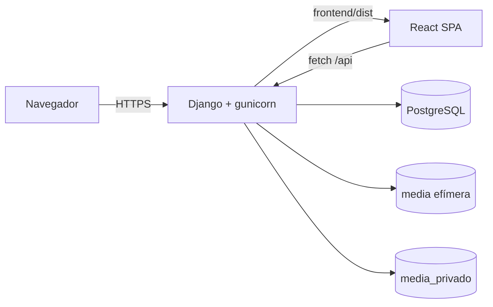
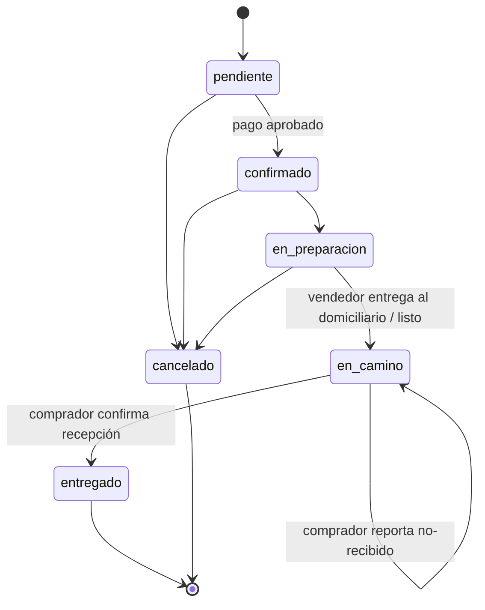

# RioMarket

Marketplace local para los puestos de mercado de Riohacha (Colombia). Incluye la **API REST** en Django/DRF y la **SPA** en React/Vite: catálogo, pedidos, pagos, verificación de vendedores, reseñas, cupones, notificaciones y auditoría.

[](https://www.python.org/) [](https://www.djangoproject.com/)
[](https://www.django-rest-framework.org/) [](https://react.dev/)
[](https://www.postgresql.org/) [](https://github.com/calo159/riomarket-backend/actions/workflows/ci.yml)

> **Demo:** <https://riomarket.onrender.com> (URL por defecto del Blueprint; puede variar). El plan gratuito de Render duerme el servicio tras unos minutos sin tráfico: la primera visita puede tardar cerca de un minuto en responder.

## Contenido

- [Qué es](#qué-es-riomarket) · [Funcionalidades](#funcionalidades-y-estado) · [Arquitectura](#arquitectura) · [Stack](#stack) · [Inicio](#inicio-rápido) · [Datos](#datos-demo)
- [Configuración](#configuración) · [Autenticación](#autenticación-y-roles) · [API](#api) · [Frontend](#frontend) · [Pruebas](#pruebas)
- [Despliegue](#despliegue-en-render) · [Seguridad](#seguridad-y-limitaciones) · [Estructura](#estructura) · [Documentación](#documentación) · [Problemas](#solución-de-problemas) · [Roadmap](#roadmap) · [Contribuir y licencia](#contribuir-licencia-y-autores)

## Qué es RioMarket

RioMarket conecta vendedores de puestos con compradores locales sin obligarlos a montar una tienda propia. Un pedido pertenece a **un solo puesto**; el servidor calcula los montos, congela los precios y descuenta el stock de forma transaccional. Los roles son **comprador**, **vendedor** y **administrador**: el vendedor debe estar verificado para publicar y el comprador solo puede reseñar pedidos entregados.

## Funcionalidades y estado

| Área | Estado | Detalle |
| --- | --- | --- |
| Sesión | Listo | JWT de acceso en memoria + refresh en cookie HttpOnly |
| Catálogo y compra | Listo | Puestos, categorías, productos, imágenes, filtros, carrito y checkout |
| Pedidos | Listo | Un puesto por pedido, estados, stock transaccional y cancelación |
| Pagos | Listo (sandbox) | Efectivo confirmado por el vendedor y simulación; sin pasarela real |
| Verificación | Listo | Cédula cifrada, foto privada y aprobación o rechazo por el administrador |
| Reseñas, cupones y avisos | Listo | Reseñas solo de pedidos entregados; cupones por puesto; correo opcional |
| Paneles | Listo | Comprador, vendedor y administrador en una sola SPA |
| Usuarios y pasarela | No incluido | Sin CRUD de usuarios, cambio de clave ni pago real |

## Arquitectura

En desarrollo, Vite sirve la SPA en el puerto 3000 y hace proxy de `/api` y `/media` hacia Django (puerto 8000). En producción, Django con WhiteNoise sirve el build de la SPA y mantiene la API bajo `/api`, de modo que todo vive en el mismo origen.



`accounts` es la base; `catalog` depende de ella; `orders` y `payments` dependen de ambas; `common` es transversal; `addresses`, `notifications`, `reviews`, `promotions` y `audit` se apoyan en las anteriores. Cada app separa `models / serializers / services / views / urls / tests`, y las reglas de negocio viven en `services.py`.

### Flujo de un pedido



El vendedor confirma, pasa a preparación y marca **en camino** (ya entregó el pedido al domiciliario o está listo para retirar); **no** puede marcarlo entregado. Solo el comprador (o el administrador, para resolver disputas) confirma la recepción. Si el pedido está en camino y no llega, el comprador puede reportarlo: el estado no cambia, se registra el aviso y se notifica al vendedor; si luego llega, aún puede confirmarlo. El comprador o el vendedor pueden cancelar mientras el pedido no haya salido del puesto. Al cancelar se repone el stock y se reembolsa o anula el pago. El comprador paga `subtotal + domicilio - descuento` y la comisión de la plataforma se descuenta al vendedor.

## Stack

| Capa | Tecnología |
| --- | --- |
| Backend | Python 3.12, Django 5.2, DRF 3.18, SimpleJWT, drf-spectacular |
| Datos | PostgreSQL 16 (Render o Supabase); SQLite en memoria para las pruebas |
| Frontend | React 18, TypeScript estricto, Vite 5, React Router 6, TanStack Query, Tailwind |
| Calidad | pytest, ruff, Vitest, Testing Library, Playwright, ESLint, GitHub Actions |
| Entrega | Docker Compose para desarrollo; Render para la demo |

## Inicio rápido

Requisitos: Python 3.12, Node.js 20+ y PostgreSQL 16 (o Docker). El repositorio incluye un `.env` para la demo; haz una copia antes de reemplazarlo.

### 1. Backend

**Con Docker:**

```bash
git clone https://github.com/calo159/riomarket-backend.git
cd riomarket-backend
docker compose up --build -d
docker compose exec web python manage.py migrate
docker compose exec web python manage.py seed_masivo
```

**Sin Docker:**

```bash
git clone https://github.com/calo159/riomarket-backend.git
cd riomarket-backend
python -m venv .venv
.venv\Scripts\Activate.ps1    # Windows PowerShell
source .venv/bin/activate     # Linux/macOS (usa solo la línea de tu sistema)
pip install -r requirements-dev.txt
python manage.py migrate
python manage.py seed_masivo
python manage.py runserver
```

El `.env` incluido apunta a la base de la demo; si prefieres otra base, haz una copia del archivo y cambia `DATABASE_URL`. El backend queda en <http://127.0.0.1:8000>: salud en `/api/health/`, Swagger en `/api/docs/`, Redoc en `/api/docs/redoc/`, esquema en `/api/schema/` y administración en `/admin/`.

### 2. Frontend (otra terminal)

```bash
cd frontend
npm ci
cp .env.example .env          # Windows: copy .env.example .env
npm run dev
```

### 3. Abrir la aplicación

Entra a <http://127.0.0.1:3000> (usa `127.0.0.1`, no `localhost`: la cookie de sesión es `SameSite=Strict`) e inicia sesión con alguno de los usuarios de la sección siguiente.

## Datos demo

Contraseña para todos: `RioMarket2026!` (se cambia con `--password` o con `SEED_DEMO_PASSWORD`).

| Rol | Correo |
| --- | --- |
| Administrador | `admin@riomarket.test` |
| Vendedor aprobado | `carmen@riomarket.test` |
| Vendedor aprobado | `diego@riomarket.test` |
| Comprador | `luis@riomarket.test` |

`seed_masivo` es idempotente y, en una base limpia, crea **15 usuarios y 522 registros de dominio**: 8 categorías, 6 puestos, 40 productos, 30 pedidos, 28 pagos, 123 notificaciones y 191 registros de auditoría. `seed_demo` crea solo 28 registros. En Render se ejecuta `seed_masivo` en cada arranque: actualiza las contraseñas demo y siembra lo que falte.

Los IDs de los ejemplos de [`docs/api-ejemplos.md`](docs/api-ejemplos.md) corresponden a una base recién sembrada.

### Prueba rápida (3 minutos)

1. Entra como **comprador** (`luis@riomarket.test`), busca un producto y agrégalo al carrito.
2. Haz el checkout eligiendo retiro o domicilio y paga (efectivo o simulado).
3. Entra como **vendedor** (`carmen@riomarket.test`), confirma el pago en efectivo y avanza el pedido: confirmado, en preparación, en camino.
4. Vuelve como comprador, confirma la recepción del pedido (`entregado`) y deja una reseña. Si quieres probar el reporte, antes de confirmar usa **No me ha llegado**: se avisa al vendedor y el pedido sigue en camino.
5. Entra como **administrador** (`admin@riomarket.test`) y revisa pedidos, pagos y auditoría.

## Configuración

`.env.example` documenta todas las variables; las principales son:

| Variable | Uso | Demo |
| --- | --- | --- |
| `DEBUG` / `DJANGO_SETTINGS_MODULE` | Entorno activo | `True` / `config.settings.dev` |
| `SECRET_KEY` / `FERNET_KEY` | Firma y cifrado; Fernet es obligatoria en producción | Valores de demo |
| `ALLOWED_HOSTS` | Hosts permitidos | `localhost,127.0.0.1,web` |
| `DATABASE_URL` / `CONN_MAX_AGE` | PostgreSQL y persistencia de conexiones | Supabase / `60` |
| `CORS_ALLOWED_ORIGINS` / `CSRF_TRUSTED_ORIGINS` | Orígenes de la SPA y HTTPS | Local / `https://*.onrender.com` |
| `DOMICILIO_TARIFA_BASE` / `PLATFORM_COMMISSION_PERCENTAGE` | Tarifa de domicilio y comisión | `3000.00` / `5.00` |
| `PAYMENTS_SANDBOX_ENABLED` / `SEED_DEMO` | Sandbox de pagos y seed en Render | `True` / `true` |

Para producción genera las claves así:

```bash
python -c "from django.core.management.utils import get_random_secret_key; print(get_random_secret_key())"   # SECRET_KEY
python -c "from cryptography.fernet import Fernet; print(Fernet.generate_key().decode())"                   # FERNET_KEY
```

## Autenticación y roles

- El `access` JWT viaja en `Authorization: Bearer` y vive solo en memoria en la SPA. Dura 15 minutos por defecto.
- El `refresh` viaja en la cookie `rm_refresh`: `HttpOnly`, `SameSite=Strict`, `Secure` fuera de desarrollo y `path=/api/auth/`. **No** se devuelve en el cuerpo del login.
- Renovar y cerrar sesión exigen la cabecera `X-Requested-With: XMLHttpRequest`; el frontend la envía automáticamente. El refresh rota y el anterior queda en lista negra.
- El login devuelve `{access, usuario}`. Si el refresh falla, la SPA limpia la sesión y redirige a `/login?expirada=1`.
- **Comprador:** compra, direcciones y reseñas. **Vendedor:** catálogo propio, pedidos y cupones. **Administrador:** verificaciones, pagos, catálogo y auditoría.

El flujo completo con `curl` y respuestas reales está en [`docs/api-ejemplos.md`](docs/api-ejemplos.md); la demo de 6 pasos, en [`entrega/flujo_prueba.curl.md`](entrega/flujo_prueba.curl.md).

## API

La API está documentada con OpenAPI (Swagger en `/api/docs/`). Módulos principales:

| Módulo | Prefijo | Recursos |
| --- | --- | --- |
| Autenticación | `/api/auth/` | Registro, login, refresh, logout y perfil |
| Catálogo | `/api/catalog/` | Categorías, puestos, productos e imágenes |
| Pedidos y pagos | `/api/orders/` · `/api/payments/` | Estados, ítems, efectivo, sandbox y webhook |
| Direcciones y verificación | `/api/addresses/` · `/api/verificacion/` | Libreta de direcciones y revisión de vendedores |
| Reseñas y promociones | `/api/reviews/` · `/api/promotions/` | Reseñas, respuestas, cupones y su validación |
| Notificaciones, auditoría y salud | `/api/notifications/` · `/api/audit/` · `/api/health/` | Bandeja, consulta para el administrador y estado del servicio |

La paginación usa `page`, `page_size` (máximo 100) y `ordering` con listas blancas por módulo. Los errores tienen siempre la forma `{"success": false, "status_code": 400, "errors": {...}}`.

## Frontend

La SPA está en [`frontend/`](frontend/README.md); su estado y sus limitaciones están en [`frontend/README.md#estado-de-cumplimiento`](frontend/README.md#estado-de-cumplimiento). Los comandos de arranque están en [Inicio rápido](#2-frontend-otra-terminal).

- **Comprador** (`/`): catálogo, carrito, checkout, pedidos, direcciones y perfil.
- **Vendedor** (`/vendedor`): puestos, productos, pedidos, cupones, reseñas y verificación.
- **Administrador** (`/admin`): verificaciones, pedidos, pagos, puestos, cupones y auditoría.

Vite corre en `127.0.0.1:3000` y hace proxy de `/api` y `/media`. Si defines `VITE_API_URL`, usa el mismo host de la SPA para que la cookie `SameSite=Strict` siga siendo del mismo sitio. El acceso rápido con las cuentas demo del login se activa con `VITE_DEMO_MODE=true`.

### Permisos de pedidos por rol

La fuente de verdad es `apps/orders/permissions.py`; el comprador solo actúa
sobre **su** pedido y el vendedor sobre los de **su** puesto. El administrador
resuelve disputas y no crea pedidos. `acciones_permitidas` de la API expone
esta matriz combinada con el estado actual.

| Acción | Comprador | Vendedor del puesto | Administrador |
| --- | :---: | :---: | :---: |
| Crear pedido | ✅ | — | — |
| Editar dirección/notas (pendiente) | ✅ | — | ✅ |
| Confirmar pedido | — | ✅ | ✅ |
| Pasar a preparación | — | ✅ | ✅ |
| Marcar en camino / listo para retirar | — | ✅ | ✅ |
| Confirmar recepción (`entregado`) | ✅ | — | ✅ |
| Reportar `no-recibido` (en camino) | ✅ | — | ✅ |
| Cancelar | ✅ | ✅ | ✅ |

## Pruebas

Backend:

```bash
pytest -q
ruff check apps config tests --no-cache
ruff format --check apps config tests
python manage.py makemigrations --check --dry-run
python manage.py spectacular --file schema.yaml --validate
```

Resultado actual: **589 pruebas en verde**, lint y formato correctos, sin migraciones pendientes y sin errores de OpenAPI (queda un aviso por nombres de `enum`). La suite usa SQLite en memoria; para probar contra PostgreSQL real, exporta `TEST_DATABASE_URL`.

Frontend (`cd frontend`):

```bash
npm run lint
npm run typecheck
npm test
npm run build
```

Resultado: **21 pruebas en 5 archivos**, con lint, typecheck y build en verde. El smoke test E2E se ejecuta con `npm run test:e2e` después de `npx playwright install chromium`.

Dependencias: `pip-audit -r requirements.txt` no reporta vulnerabilidades conocidas. `npm audit` mantiene **12 avisos** (2 críticos, 2 altos y 8 moderados), principalmente en herramientas de desarrollo; el detalle está en [`docs/MANTENIMIENTO.md`](docs/MANTENIMIENTO.md).

## Despliegue en Render

`render.yaml` crea un servicio Docker y una base PostgreSQL 16 gratuita. `scripts/render-start.sh` ejecuta `collectstatic`, `migrate`, `seed_masivo` y `seed_imagenes_demo`, y luego inicia gunicorn. `Dockerfile.render` compila la SPA y WhiteNoise sirve los archivos estáticos.

1. Sube el repositorio a GitHub (rama `main`).
2. En Render, elige **New → Blueprint** y conecta el repositorio.
3. Confirma los recursos y espera a que termine el deploy.
4. Verifica `/api/health/`, `/api/docs/` y `/`.

La URL depende del nombre del servicio; la del Blueprint es `https://riomarket.onrender.com`. Límites del plan gratuito: el servicio se duerme, la base **caduca a los 30 días** y el disco es efímero. Para una base duradera usa Supabase y reemplaza `DATABASE_URL`. Más detalles en [`docs/despliegue.md`](docs/despliegue.md).

## Seguridad y limitaciones

- No hay pasarela de pago real: solo existe `PasarelaSandbox`. En producción real hay que desactivar `PAYMENTS_SANDBOX_ENABLED` e integrar un proveedor.
- El correo es opcional y depende de SMTP; la demo usa solo avisos dentro de la aplicación.
- No hay administración de usuarios ni cambio de contraseña.
- `media/` y `media_privado/` usan disco local, que es efímero en Render. La foto de la cédula se cifra y se sirve solo por una vista autorizada.
- Las imágenes y la cédula se validan por tipo y tamaño; los tokens y secretos no se registran en los logs.
- **`.env` está versionado a propósito para la entrega** y contiene credenciales de la demo. El repositorio es público: cuando termine la calificación, rota la contraseña de la base o haz el repositorio privado.
- No hay archivo `LICENSE`; el responsable debe elegir uno antes de reutilizar el código fuera del contexto académico.

El detalle de los controles (JWT, cookies, CSP, cifrado con Fernet, límites de peticiones y permisos) está en [`SEGURIDAD.md`](SEGURIDAD.md).

## Estructura

```text
riomarket-backend/
├── apps/                  # accounts, catalog, orders, payments, addresses,
│                          # notifications, reviews, promotions, audit, common
├── config/                # settings dev/test/prod, URLs, WSGI y ASGI
├── docs/                  # arquitectura, API, despliegue, ADRs y presentación
├── entrega/               # guía, flujo curl, respaldos de datos y Postman
├── frontend/              # SPA React/Vite, pruebas y configuración
├── scripts/               # arranque en Render
├── tests/                 # pruebas transversales y factories
├── .github/workflows/     # CI de backend y frontend
├── Dockerfile             # desarrollo (docker-compose)
├── Dockerfile.render      # producción (compila la SPA y arranca gunicorn)
├── docker-compose.yml     # PostgreSQL, Redis y backend
├── render.yaml            # Blueprint de Render
├── requirements.txt / requirements-dev.txt
└── manage.py
```

## Documentación

- **Guías:** [Índice](docs/README.md) · [Arquitectura y permisos](docs/arquitectura.md) · [Ejemplos de la API](docs/api-ejemplos.md) · [Despliegue](docs/despliegue.md) · [Alcance del frontend](docs/alcance-frontend.md)
- **Proyecto:** [Mantenimiento](docs/MANTENIMIENTO.md) · [Presentación](docs/PRESENTACION.md) · [Seguridad](SEGURIDAD.md)
- **Entrega:** [Guía de entrega](entrega/LEEME_ENTREGA.md) · [Flujo curl](entrega/flujo_prueba.curl.md) · [Colección Postman](entrega/riomarket_postman.json)
- **Decisiones (ADR):** [enums](docs/ADR-001-enums.md) · [media](docs/ADR-002-media-publica-y-privada.md) · [pagos](docs/ADR-003-pagos.md) · [direcciones](docs/ADR-004-direcciones-y-notificaciones.md) · [reseñas](docs/ADR-005-reputacion-resenas.md) · [cupones](docs/ADR-006-promociones-cupones.md) · [auditoría](docs/ADR-007-auditoria.md)

## Solución de problemas

- **`no such table` o migraciones pendientes:** ejecuta `migrate` y luego `seed_masivo`.
- **`FERNET_KEY es obligatoria`:** define una clave Fernet cuando `DEBUG=False`; no actives `DEBUG` en producción.
- **401 al renovar la sesión:** la cookie es `SameSite=Strict`; abre la SPA en `127.0.0.1:3000` y no mezcles `localhost` con `127.0.0.1`. Revisa también `CORS_ALLOWED_ORIGINS`.
- **Render tarda en responder:** el plan gratuito durmió el servicio; la primera petición puede tardar cerca de un minuto.
- **Las imágenes desaparecen en Render:** el disco es efímero; usa almacenamiento externo en producción.
- **Playwright no arranca:** ejecuta `npx playwright install chromium`.
- **Puerto 3000 ocupado:** Vite usa `strictPort`; libera el puerto o cierra la otra instancia.

## Roadmap

- Integrar una pasarela de pago real con webhooks firmados y conciliación.
- Añadir administración de usuarios y cambio de contraseña.
- Enviar correos transaccionales y notificaciones en tiempo real.
- Migrar los archivos subidos a almacenamiento durable y ampliar las pruebas E2E por rol.

## Contribuir, licencia y autores

Crea una rama desde `main`, mantén los cambios pequeños, añade pruebas, ejecuta los comandos de la sección de pruebas y abre un pull request. No incluyas secretos reales en commits nuevos.

**Licencia:** no hay `LICENSE`;

**Autor:** [`carlos sierra , yerfrreth mejia`]. 