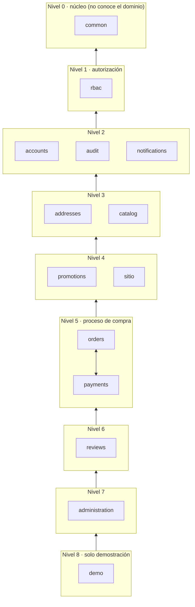
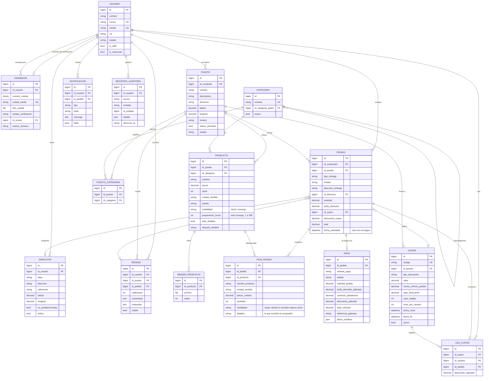

# Arquitectura de RioMarket Backend

Documento de apoyo del [README](../README.md). Contiene el detalle que haría
ruido en la portada: dependencias entre apps, modelo entidad-relación completo
y matriz de permisos por rol. Los diagramas de secuencia (checkout, retiro con
cobro, apartar con plazo, encargo), el de despliegue y los de estados están en
[diagramas.md](diagramas.md).

## Dependencias entre apps

Las apps forman **capas** y cada una importa solo de las de nivel menor; el detalle y las razones están en
[ADR-017](ADR-017-arquitectura-en-capas.md) y una prueba (`tests/test_arquitectura.py`) lo hace cumplir.

Si una app de nivel bajo necesita algo de una de nivel alto, **no importa hacia arriba**: define un punto de
extensión y la app alta se registra al arrancar (`AppConfig.ready`). Hay dos:

- **Insignias del menú** (`rbac.menu.registrar_insignia`): `orders`, `payments`, `notifications` y `accounts`
  aportan los contadores de sus recursos.
- **Anotaciones del catálogo** (`catalog.anotaciones.registrar_anotador`): `reviews` aporta la reputación de los
  puestos y la calificación del puesto de cada producto.

`orders` ↔ `payments` es la única dependencia mutua aceptada (un pedido y su cobro son el mismo proceso). Ya no
hay imports diferidos para esquivar ciclos: todos los imports entre apps van al inicio del archivo.

## Modelo entidad-relación

Campos y relaciones tomados directamente de `apps/*/models.py`. Las claves
`PROTECT` preservan el historial; las `SET_NULL` dejan el rastro vivo aunque se
borre la entidad referenciada.

> El campo lógico `password_hash` se implementa con `password` de
> `AbstractBaseUser` (hash PBKDF2). Ver
> [ADR-001](ADR-001-enums.md#decisión-relacionada-password_hash).

## Matriz de permisos por rol

Roles reales: **anónimo**, **comprador**, **vendedor** (cuenta activa sin
verificación aprobada), **vendedor aprobado** y **administrador**. El
administrador puede todo lo que aparece abajo.

| Módulo / acción | Anónimo | Comprador | Vendedor | Vendedor aprobado | Admin |
| --- | :---: | :---: | :---: | :---: | :---: |
| Registro / login / refresh | ✅ | ✅ | ✅ | ✅ | ✅ |
| Ver y editar el propio perfil | ⬜ | ✅ | ✅ | ✅ | ✅ |
| Enviar solicitud de verificación | ⬜ | ⬜ | ✅ | ✅ | ⬜ |
| Cola de verificación y decisión | ⬜ | ⬜ | ⬜ | ⬜ | ✅ |
| Ver foto de cédula | ⬜ | ⬜ | ⬜ | ⬜ | ✅ (revisor) |
| Ver catálogo (categorías, puestos, productos, imágenes) | ✅ | ✅ | ✅ | ✅ | ✅ |
| Crear/editar/borrar puesto y producto | ⬜ | ⬜ | ⬜ | ✅ (dueño) | ✅ |
| Gestionar categorías | ⬜ | ⬜ | ⬜ | ⬜ | ✅ |
| Crear pedido | ⬜ | ✅ | ⬜ | ⬜ | ⬜ |
| Ver/listar pedidos | ⬜ | ✅ (suyos) | ✅ (de sus puestos) | ✅ (de sus puestos) | ✅ |
| Confirmar / preparar / enviar (domicilio) / marcar listo para recoger (retiro) | ⬜ | ⬜ | ⬜ | ✅ (dueño) | ✅ |
| Confirmar recepción (`entregado`) | ⬜ | ✅ (suyo; en retiro con efectivo sin cobrar no) | ⬜ | ✅ (solo retiro: entrega y cobra) | ✅ |
| Reportar `no-recibido` (domicilio en camino) | ⬜ | ✅ (suyo) | ⬜ | ⬜ | ✅ |
| Cancelar pedido | ⬜ | ✅ (suyo) | ✅ (de sus puestos) | ✅ (de sus puestos) | ✅ |
| Dar más tiempo a un retiro (`extender-plazo`, máx. 2 veces) | ⬜ | ⬜ | ⬜ | ✅ (dueño) | ✅ |
| Cancelado por el sistema (plazo vencido, auditoría «Sistema») | — | — | — | — | — |
| Registrar pago | ⬜ | ✅ (suyo) | ⬜ | ⬜ | ✅ |
| Simular pago (sandbox) | ⬜ | ✅ (suyo) | ⬜ | ⬜ | ✅ |
| Confirmar cobro en efectivo | ⬜ | ⬜ | ⬜ | ✅ (dueño) | ✅ |
| Reembolsar / anular pago | ⬜ | ⬜ | ⬜ | ⬜ | ✅ |
| Ver ventas (`/api/payments/ventas/`, recurso `vendedor.ventas`) | ⬜ | ⬜ | ⬜ | ✅ (solo sus puestos) | ✅ (todo el mercado) |
| Gestionar direcciones propias | ⬜ | ✅ | ✅ | ✅ | ✅ (todas) |
| Ver/marcar notificaciones propias | ⬜ | ✅ | ✅ | ✅ | ✅ (todas) |
| Listar reseñas públicas | ✅ | ✅ | ✅ | ✅ | ✅ |
| Crear reseña (pedido entregado) | ⬜ | ✅ | ⬜ | ⬜ | ⬜ |
| Responder reseña | ⬜ | ⬜ | ⬜ | ✅ (dueño) | ✅ |
| Crear cupón de puesto | ⬜ | ⬜ | ⬜ | ✅ (dueño) | ✅ |
| Crear cupón global | ⬜ | ⬜ | ⬜ | ⬜ | ✅ |
| Validar cupón en checkout | ⬜ | ✅ | ✅ | ✅ | ✅ |
| Ver auditoría | ⬜ | ⬜ | ⬜ | ⬜ | ✅ |
| Health check | ✅ | ✅ | ✅ | ✅ | ✅ |
