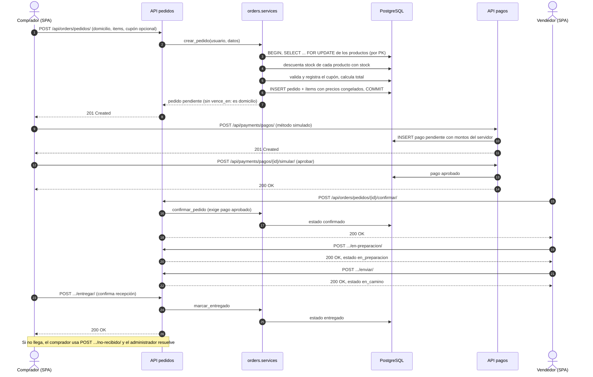
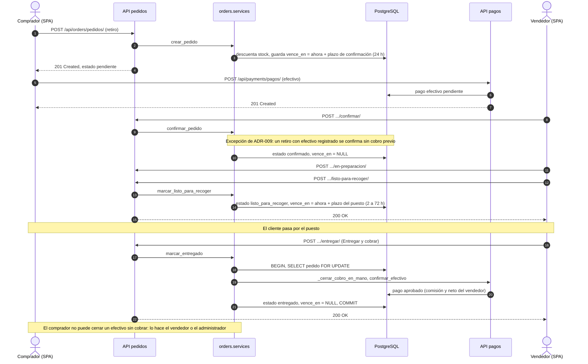
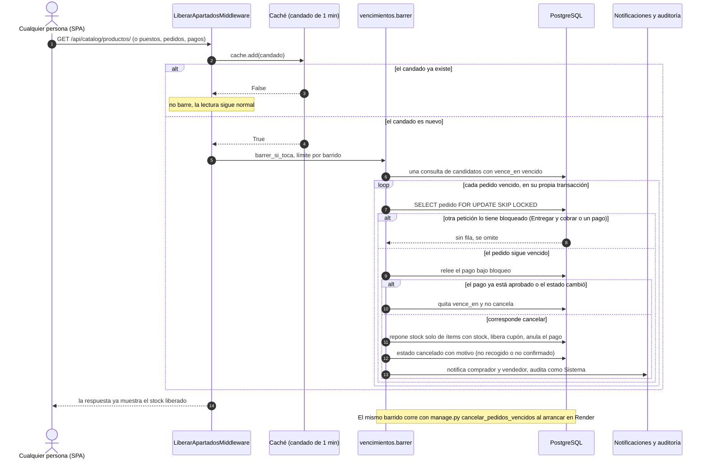
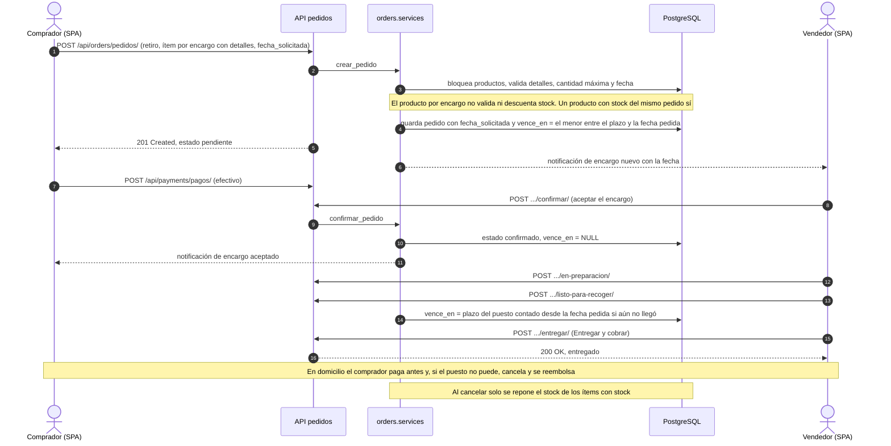
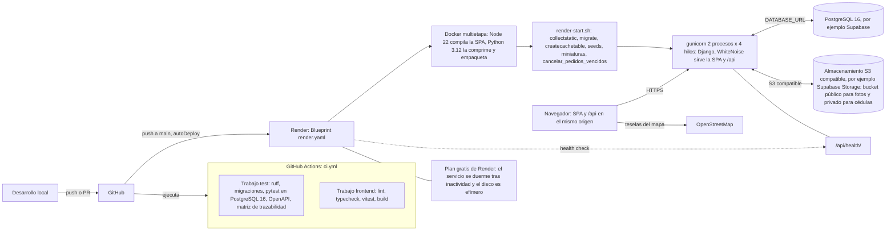
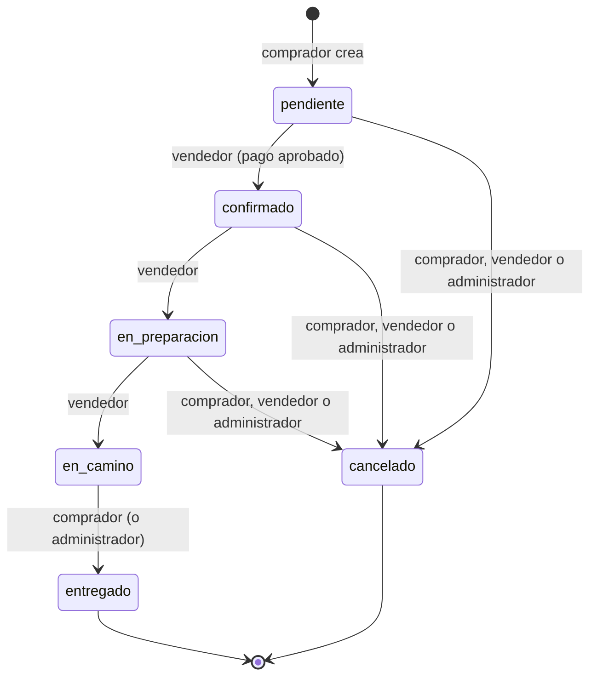
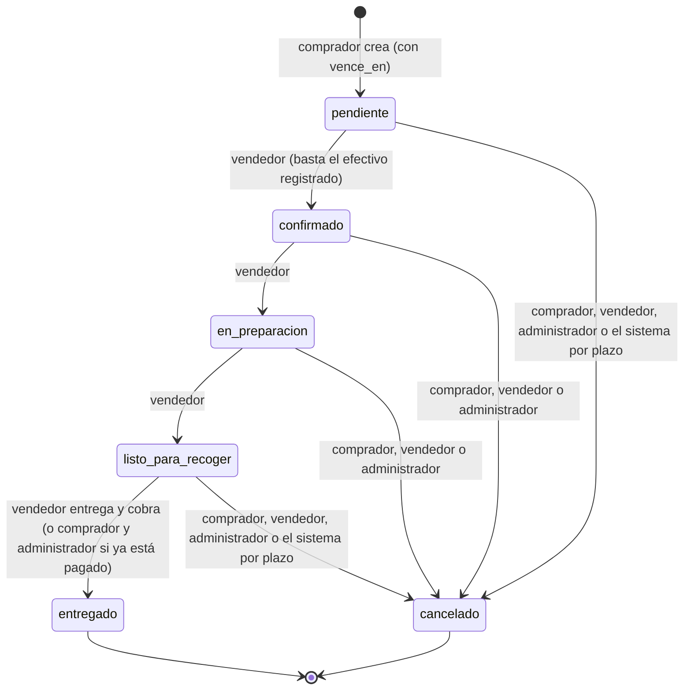

# Diagramas

Diagramas [Mermaid](https://mermaid.js.org/) que GitHub dibuja directamente. Cada uno sale del código
que describe (se cita el archivo y la función) y se validó con el analizador de Mermaid (ver
«Cómo se validaron» al final). Si el código cambia, el diagrama debe cambiar con él.

Contenido: [1. Checkout y pago a domicilio](#1-checkout-y-pago-a-domicilio-con-pago-sandbox) ·
[2. Retiro con pago al recoger](#2-retiro-con-pago-al-recoger-y-entregar-y-cobrar) ·
[3. Apartar con plazo](#3-apartar-con-plazo-liberación-automática-del-stock) ·
[4. Producto por encargo](#4-producto-por-encargo) · [5. Despliegue](#5-despliegue) ·
[6. Estados del pedido](#6-estados-del-pedido-por-tipo-de-entrega).

## 1. Checkout y pago a domicilio (con pago sandbox)

Código: `crear_pedido` y `_aplicar_transicion` en `apps/orders/services.py`, `crear_pago` y
`simular_pago` en `apps/payments/services.py`, `frontend/src/pages/Checkout.tsx` y
`frontend/src/pages/pedido/ModalesPedido.tsx`. En domicilio el vendedor **no puede confirmar** hasta
que el pago esté aprobado (`_exigir_pago_para_confirmar`) y solo el comprador cierra la entrega.



## 2. Retiro con pago al recoger y «Entregar y cobrar»

Código: `crearPedidoConPagoAlRecoger` en `frontend/src/api/orders.ts`, `_exigir_pago_para_confirmar`,
`_cerrar_cobro_en_mano` y `_plazo_al_pasar_a` en `apps/orders/services.py`, `confirmar_efectivo` en
`apps/payments/services.py` ([ADR-009](ADR-009-retiro-y-pago-al-recoger.md)). El cobro y la entrega
ocurren en **una sola transacción**: si el cobro falla, el pedido no queda entregado.



## 3. Apartar con plazo: liberación automática del stock

Código: `LiberarApartadosMiddleware` (`apps/orders/middleware.py`), `barrer_si_toca`, `barrer`,
`_procesar_vencido` y `cancelar_vencidos` (`apps/orders/vencimientos.py`), `_aplicar_transicion`
(`apps/orders/services.py`) y el arranque `scripts/render-start.sh`
([ADR-012](ADR-012-apartar-con-plazo.md)). No hay cron: el barrido es **perezoso** (al leer, como mucho
una vez por minuto por proceso) y también corre al arrancar el servicio.



## 4. Producto por encargo

Código: `crear_pedido`, `_validar_linea_de_encargo`, `_resolver_fecha_solicitada` y
`_plazo_al_pasar_a` en `apps/orders/services.py`, `_reponer_stock`
([ADR-013](ADR-013-productos-por-encargo.md)). Un encargo no usa stock: se valida su cantidad máxima
(20), sus detalles y la fecha pedida (desde la mayor preparación del pedido hasta 60 días). «Aceptar»
es el mismo `confirmar` de siempre.



## 5. Despliegue

Fuentes: `.github/workflows/ci.yml`, `render.yaml`, `Dockerfile.render`, `scripts/render-start.sh` y
[docs/despliegue.md](despliegue.md).



Notas: `DATABASE_URL` y las claves de almacenamiento las define el dueño en Render (no están en el
repositorio). Sin las variables `STORAGE_S3_*` el sistema usa el disco local, que es efímero en Render
(las fotos demo se recrean en cada arranque con `seed_imagenes_demo`). El CI usa un contenedor de
PostgreSQL 16 solo para las pruebas.

## 6. Estados del pedido por tipo de entrega

Tablas reales: `TRANSICIONES_POR_TIPO` en `apps/orders/services.py`. «Cancelado por el sistema» es el
barrido de vencidos de la sección 3 (solo retiros, solo desde `pendiente` o `listo_para_recoger`).

### Domicilio



### Retiro en el puesto



## Cómo se validaron

Los siete bloques Mermaid de este archivo se validaron con el analizador oficial de `mermaid`
(`mermaid.parse`, versión 11.4.1, la librería que usa GitHub para dibujarlos) ejecutado en Node con
`jsdom`, en una carpeta temporal fuera del repositorio: no se añadió ninguna dependencia al proyecto.
El mismo script rechaza un diagrama con errores de sintaxis, lo que comprueba que la validación no es
vacía. Para repetirlo:

```bash
mkdir /tmp/mmd && cd /tmp/mmd && npm init -y && npm install mermaid@11.4.1 jsdom@25
# validar.mjs: carga jsdom como window/document, importa mermaid y llama a mermaid.parse(bloque)
# por cada bloque de código mermaid del archivo; sale con código 1 si alguno falla.
```

El analizador valida la sintaxis, no el aspecto: la vista previa de GitHub es la comprobación visual.
